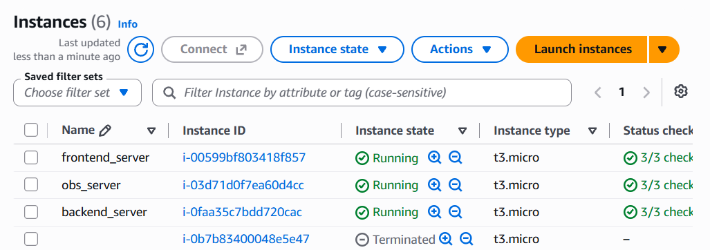
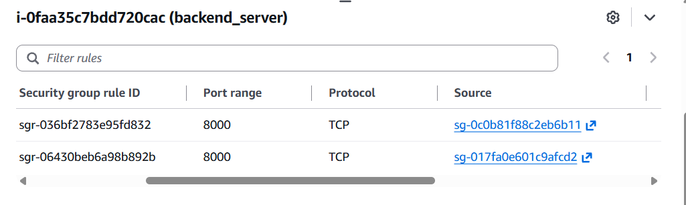
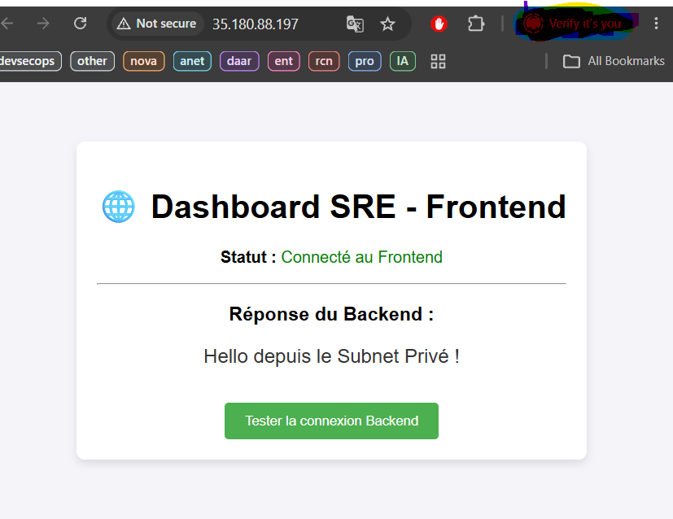
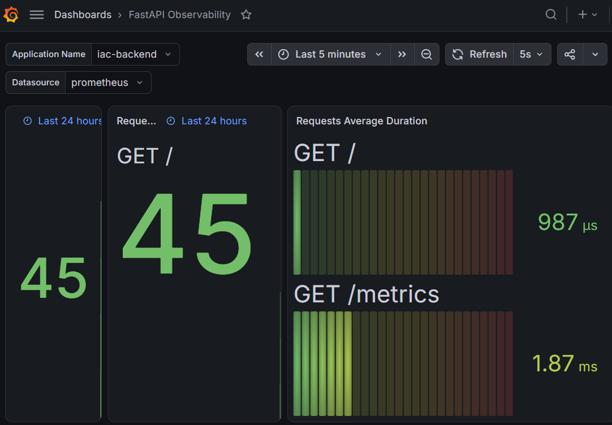
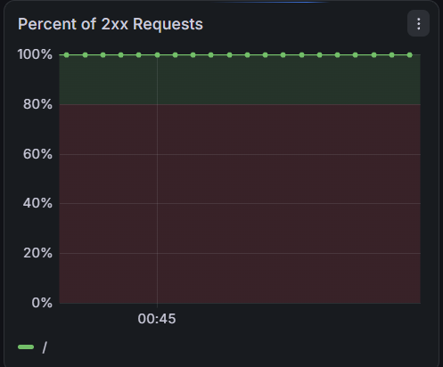
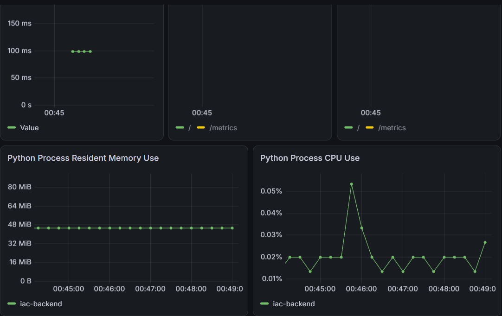

# 🚀 IaC DX Validator : Architecture DevSecOps 3-Tiers sur AWS

Ce projet démontre le déploiement entièrement automatisé et sécurisé d'une architecture web 3-Tiers (Frontend, Backend, Observabilité) sur Amazon Web Services (AWS) en utilisant l'Infrastructure as Code (Terraform) et les principes du DevOps (Docker, CI/CD).

## 🎯 Objectifs du Projet

- **Provisionnement Automatisé :** Création de l'infrastructure réseau et calcul de A à Z (VPC, Subnets, EC2, NAT Gateway) via Terraform.
- **Sécurité (DevSecOps) :** Isolation du Backend en réseau privé, whitelisting strict, et gestion du Remote State sécurisé (S3 + DynamoDB).
- **Livraison Continue (Delivery) :** Configuration des serveurs au démarrage (cloud-init/user_data) et conteneurisation des applications (Docker).
- **Observabilité SRE :** Mise en place d'une stack de monitoring (Prometheus & Grafana) pour suivre la santé de l'API.

---

## 🏗️ Architecture Réseau et Sécurité

Le projet repose sur la séparation stricte des responsabilités (Separation of Concerns) et le principe du moindre privilège.


*(Capture 1 : Les 3 instances provisionnées : Frontend, Backend, Observabilité)*

### 1. Le Réseau (VPC & Routage)
- **Subnet Public :** Héberge le `frontend_server` et l'`obs_server`. Ces instances possèdent une IP publique et sortent sur Internet via l'Internet Gateway (IGW).
- **Subnet Privé :** Héberge le `backend_server` (API). Il est mathématiquement inatteignable depuis l'extérieur. Ses mises à jour sortent via une **NAT Gateway** provisionnée dans le subnet public.

### 2. Le Chaînage de Security Groups (Firewalls)
La sécurité ne repose pas sur le filtrage d'IP locales, mais sur l'identité des composants :
- Le `backend_sg` n'accepte le trafic sur le port 8000 que s'il provient de machines possédant le badge `frontend_sg` ou `obs_sg`.
- Le `obs_sg` (Grafana/Prometheus) applique un **whitelisting strict** (`/32`), limitant l'accès administratif à ma seule adresse IP personnelle.


*(Capture 2 : Règles Ingress du Backend interdisant l'accès public)*

---

## 🛠️ Stack Technique

### Infrastructure & Déploiement
- **Terraform (IaC) :** Déclaration de l'état désiré (HCL) et gestion du *State* distant.
- **AWS S3 & DynamoDB :** Remote Backend pour le stockage du `terraform.tfstate` et le *State Locking* (Disaster Recovery).
- **GitHub Actions :** Pipeline CI/CD pour valider (`fmt`, `validate`) et planifier le code à chaque push.

### Applicatif (Conteneurisation Docker)
- **Frontend :** Vue.js servi par **Nginx** (Reverse Proxy vers l'IP privée du Backend).
- **Backend :** API REST en **Python FastAPI** (générant des métriques standardisées).
- **Observabilité :** Images officielles **Prometheus** (collecte) et **Grafana** (visualisation).

---

## 🚀 Démonstration et Preuves de Concept

### 1. Validation du Flux Applicatif
Le client accède à l'IP publique du Frontend. Nginx intercepte la requête HTTP et fait le pont (Reverse Proxy) vers le réseau privé pour interroger le Backend.


*(Capture 3 : Le Frontend public affichant la réponse du Backend privé)*

### 2. Observabilité et Télémétrie SRE
Le serveur d'observabilité (Public) parvient à traverser le réseau pour interroger (scrape) l'API privée sur la route `/metrics`.


*(Capture 4 : Prometheus confirmant la liaison réseau vers l'API privée (Status: UP))*

Les métriques sont ensuite agrégées et visualisées sur Grafana en temps réel (Taux de réussite HTTP, temps de réponse, consommation CPU/RAM).




*(Captures 5,6,7 : Dashboard Grafana illustrant un test de charge sur l'API)*

---

## 💻 Structure du Dépôt (Bootstrap & Blast Radius)

Pour protéger le coffre-fort Terraform (S3/DynamoDB) d'une destruction accidentelle, le code est partitionné :

```text
.
├── 00-backend/                 # 🔒 BOOTSTRAP (Exécuté 1 fois) : Création S3 & DynamoDB
│   └── backend.tf
│
├── 01-vpc/                     # 🌐 INFRASTRUCTURE RÉSEAU & SERVEURS
│   ├── main.tf                 # VPC, Subnets, Gateways & Déclaration Remote Backend
│   ├── ec2.tf                  # Provisionnement des 3 instances
│   ├── iam.tf                  # Sécurité IAM (Rôles & Policies)
│   ├── observability.tf        # Déploiement Prometheus & Grafana
│   ├── outputs.tf              # Extraction dynamique des IPs publiques
│   └── scripts/
│       ├── script_initialisation_backend.sh    # cloud-init : Docker build Python
│       ├── script_initialisation_frontend.sh   # cloud-init : Docker build Nginx/Vue.js
│       └── script_initialisation_obs.sh        # cloud-init : Docker run Prom/Grafana
│
├── 02-app/                     # 📦 CODE SOURCE APPLICATIF
│   ├── backend/                # Code source FastAPI
│   └── frontend/               # Code source Vue.js
│
└── .github/workflows/ci.yml    # 🤖 PIPELINE CI : terraform validate/plan sur 01-vpc/
